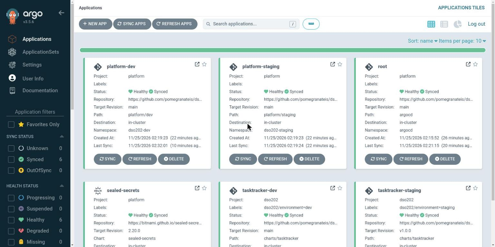
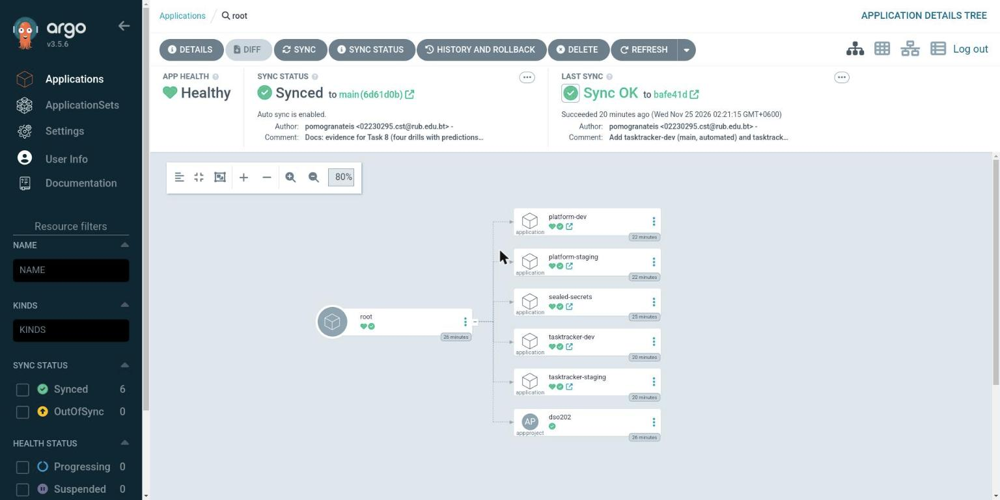
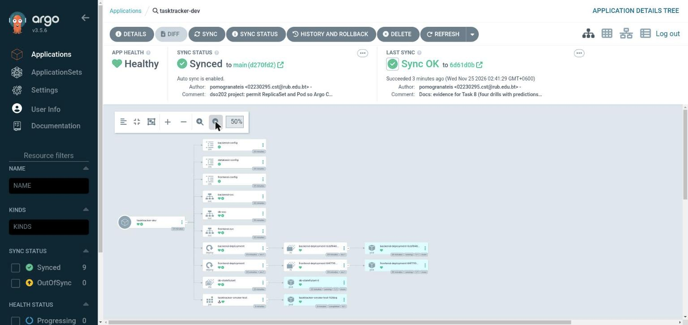
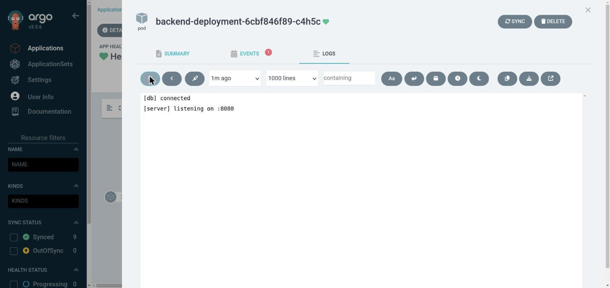
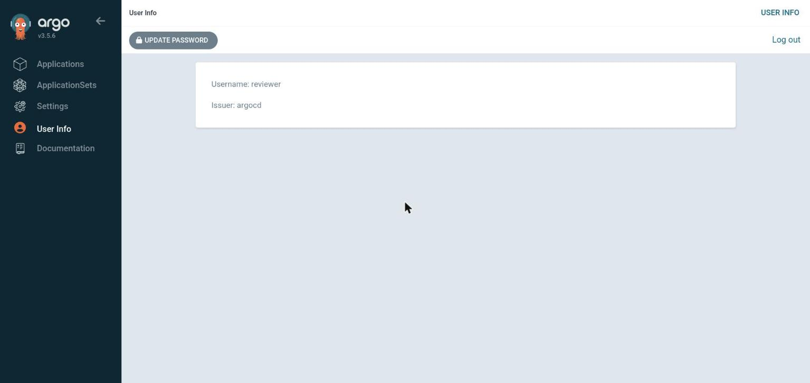
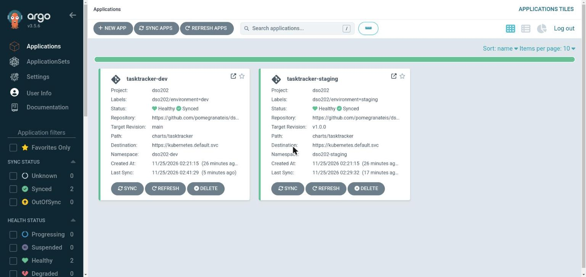
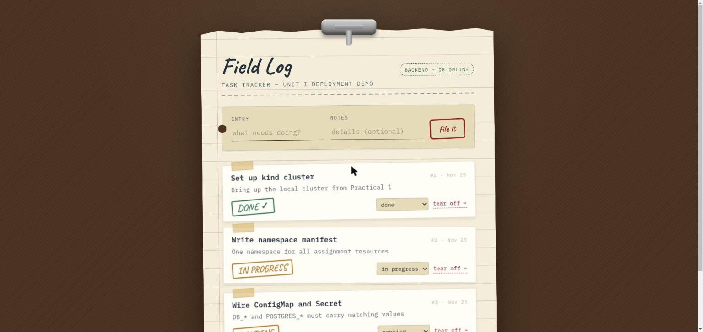

<!--
=============================================================================
File        : README.md
Assignment  : DSO202 Assignment 4
Descriptor  : Unit IV 4.1-4.4
Purpose     : What this repository is, the pinned versions, how to build the
              whole environment from an empty machine, how credentials are
              handled, how to clean up, and the written answers Q1-Q6.
=============================================================================
-->

# dso202-gitops — GitOps Delivery of the Task Tracker with Argo CD

**Module:** DSO202 — Scaling, Orchestration, Monitoring & Observability
**Assignment:** 4 (Unit IV, applied to the deliverables of Assignments 1–3)
**Author:** Pema Tshering Yangchen (2230295)

## 1. Purpose

This repository is the complete desired state of the Task Tracker (frontend, backend, PostgreSQL) in two
environments, `dev` and `staging`, and of the tooling that delivers it. Argo CD runs inside the cluster, polls
this repository every 60 seconds, and makes the cluster match it. After a two-step bootstrap, nothing is applied
by hand: a release is a commit, a promotion is a commit that moves a tag, and a recovery is a `git revert`.

| Environment | Namespace | Follows | Sync | Frontend |
| --- | --- | --- | --- | --- |
| dev | `dso202-dev` | branch `main` | automated, prune, self-heal | `http://localhost:30080` |
| staging | `dso202-staging` | a tag (currently `v1.2.0`) | manual (the promotion gate) | `kubectl port-forward`, `http://localhost:8081` |

Command output for every task is in [`docs/evidence.md`](docs/evidence.md).

## 2. Repository Layout

```text
dso202-gitops/
├── README.md                     this file
├── .gitignore                    keeps keys and plaintext Secrets out of Git (first commit)
├── cluster/kind-cluster.yaml     three-node kind cluster, host port 30080 (from Practical 1)
├── bootstrap/                    applied by hand, once per cluster
│   ├── argocd/                   Argo CD v3.5.6: pinned upstream manifest + two ConfigMap patches
│   └── root/                     the 'platform' AppProject and the root Application
├── argocd/                       watched by the root Application (app of apps)
│   ├── projects/dso202.yaml      workload AppProject (least privilege)
│   └── applications/             sealed-secrets, platform-dev/-staging, tasktracker-dev/-staging
├── platform/{dev,staging}/       namespace, quota and limits, RBAC, sealed credentials
├── charts/tasktracker/           the Assignment 3 chart, adjusted to the chart contract
├── environments/{dev,staging}/   values that differ per environment
└── docs/
    ├── evidence.md               command output, one section per task
    └── screenshots/              the screenshots referenced from evidence.md
```

Sync waves order the root's children: `dso202` project (−3) → `sealed-secrets` (−2) → `platform-dev`,
`platform-staging` (−1) → `tasktracker-dev`, `tasktracker-staging` (0). Inside the chart: database (0) → backend
(1) → frontend (2) → PostSync smoke test.

## 3. Pinned Versions

| Component | Version | Where it is pinned |
| --- | --- | --- |
| Argo CD | v3.5.6 | `bootstrap/argocd/kustomization.yaml` (upstream manifest URL at tag `v3.5.6`) |
| `argocd` CLI | v3.5.6 | matches the server |
| Sealed Secrets Helm chart | 2.20.0 | `argocd/applications/sealed-secrets.yaml` (`targetRevision`) |
| Sealed Secrets controller | 0.40.0 | installed by chart 2.20.0 |
| `kubeseal` CLI | v0.40.0 | matches the controller |
| kind / node image | v0.32.0 / `kindest/node:v1.36.1@sha256:3489c767…` | `cluster/kind-cluster.yaml` |
| kubectl / Kustomize | v1.36.0 / v5.8.1 | as in Practical 1 |
| Helm | v4.3.0 | as in Assignment 3 |
| Task Tracker images | `pomegranatei/dso202-{frontend,backend,db}:1.0` | `environments/<env>/values.yaml` |

The images are the tags issued by the module tutor, re-tagged and pushed to my own Docker Hub account (as in
Assignment 1); `pomegranatei/dso202-*:1.0` has the same image IDs as the issued `1.0` images. They are
`linux/arm64` only and run under QEMU emulation on this `x86_64` host. No file uses `latest`, `stable`, `master`
or `HEAD` as a version, and the chart's values schema rejects those tags.

## 4. Building the Environment from an Empty Machine

This is the sequence practised in Task 9. Prerequisites: Docker, kind, kubectl, Helm, git, `argocd` and
`kubeseal` at the versions above, and the sealing-key backup `../dso202-keys/sealing-key.backup.yaml`
(kept outside the repository).

```bash
# 0. Get the repository
git clone https://github.com/pomegranateis/dso202-gitops.git
cd dso202-gitops

# 1. Cluster (host port 30080 is mapped to the dev frontend)
kind create cluster --name dso202-gitops --config cluster/kind-cluster.yaml
kubectl config current-context            # kind-dso202-gitops

# 1a. Load the images from the host (section 13). Required on an x86_64 host: the Task Tracker images are
#     linux/arm64 only, so the nodes cannot pull them themselves; they were pulled on the host with
#     'docker pull --platform linux/arm64 ...'. The other images are loaded because registry pulls stall on
#     this network. This step creates no Kubernetes object.
for img in pomegranatei/dso202-frontend:1.0 pomegranatei/dso202-backend:1.0 pomegranatei/dso202-db:1.0 \
           busybox:1.37 docker.io/bitnami/sealed-secrets-controller:0.40.0 quay.io/argoproj/argocd:v3.5.6 \
           ghcr.io/dexidp/dex:v2.45.1 public.ecr.aws/docker/library/redis:8.2.3-alpine; do
  kind load docker-image "$img" --name dso202-gitops
done

# 2. Restore the sealing key BEFORE the controller exists, so the SealedSecrets in Git stay decryptable.
#    (Skip on the very first build: the controller then generates a key, which must be backed up at once.)
kubectl create namespace sealed-secrets
kubectl apply -f ../dso202-keys/sealing-key.backup.yaml

# 3. Bootstrap layer 1: Argo CD itself (server-side apply: the ApplicationSet CRD is too large for client-side)
kubectl apply -k bootstrap/argocd --server-side --force-conflicts
kubectl wait --for=condition=Available deployment --all -n argocd --timeout=300s
kubectl rollout status statefulset/argocd-application-controller -n argocd --timeout=300s

# 4. Bootstrap layer 2: the 'platform' project and the root Application. Nothing else is applied by hand.
kubectl apply -f bootstrap/root
kubectl get applications -n argocd -w     # waves -3, -2, -1, 0 appear in order

# 5. Sign in (the port-forward keeps running in its own terminal)
kubectl port-forward svc/argocd-server -n argocd 8080:443
argocd admin initial-password -n argocd
argocd login localhost:8080 --username admin --insecure

# 6. Staging is manual by design
argocd app sync tasktracker-staging

# 7. Use it
#    dev:     http://localhost:30080   (API: kubectl -n dso202-dev port-forward svc/backend-svc 8090:8080)
#    staging: kubectl -n dso202-staging port-forward svc/frontend-svc 8081:8080   -> http://localhost:8081
#             kubectl -n dso202-staging port-forward svc/backend-svc 8091:8080

# 8. Back up the sealing key again (the controller may have added a key at start-up)
kubectl get secret -n sealed-secrets -l sealedsecrets.bitnami.com/sealed-secrets-key -o yaml > ../dso202-keys/sealing-key.backup.yaml
chmod 600 ../dso202-keys/sealing-key.backup.yaml
```

Every image uses the `IfNotPresent` pull policy, so the loaded images are used. In Task 9 this sequence took
**3 min 18 s** from `kind delete cluster` to a working dev frontend, and staging was back on its tag after one manual
sync (evidence, Task 9).

### Why the UI needs a port-forward for the API

The frontend writes `BACKEND_URL` into `config.js` at start-up, and the browser calls that address directly; the
frontend does not proxy `/api`. No ingress controller is installed in this assignment and the backend is never
exposed as a NodePort (Assignment 1 rule), so each environment's `BACKEND_URL` points at a local port-forward:
`http://localhost:8090` (dev) and `http://localhost:8091` (staging).

## 5. How Credentials Are Handled

- The chart never renders a `Secret` (chart contract C3). Pods read `DB_USER`, `DB_PASSWORD`, `POSTGRES_USER`
  and `POSTGRES_PASSWORD` from the Secret `tasktracker-credentials`, named by `existingSecret`.
- That Secret is created in each namespace by the Sealed Secrets controller from
  `platform/<env>/tasktracker-credentials.sealed.yaml`. Each file was encrypted with `kubeseal` for its own
  name and namespace (strict scope); dev and staging have different user names and passwords.
- The plaintext input existed only in the git-ignored `secrets-plain/` directory, was never written as a
  Secret manifest (`kubectl create --dry-run=client | kubeseal`), and was deleted after sealing. The values are
  kept outside the repository.
- The controller's private sealing key is backed up to `../dso202-keys/` (mode `600`), outside the
  repository, and backed up again after every rebuild.
- A search of the whole Git history for every credential value, plain and base64-encoded, finds nothing
  (evidence, Task 4).

## 6. Cleanup

```bash
# Remove everything Argo CD created, then Argo CD itself, by deleting the cluster:
kind delete cluster --name dso202-gitops
# The sealing-key backup and the credential values in ../dso202-keys/ are kept on purpose.
# To remove them as well (this makes every SealedSecret in Git permanently undecryptable):
#   rm -r ../dso202-keys
```

Deleting the `root` Application (`kubectl delete application root -n argocd`) would also remove every child
Application and every workload through the finalizers; it is not part of normal operation.

## 7. Deviations and Notes

- **Database as a StatefulSet.** The Assignment 3 chart used a Deployment and a PVC (as in Assignment 1). Here
  the database is the Assignment 2 StatefulSet, so the chart renders exactly the five kinds in the project
  whitelist; the PVC comes from `volumeClaimTemplates`.
- **Whitelist.** `ServiceAccount` was removed from Listing 8's whitelist because the chart renders none.
  `ReplicaSet` and `Pod` were added (commit `d270fd2`): the chart does not render them, but Argo CD leaves
  kinds the project does not permit out of the resource tree, so the Pods were invisible and no Pod logs could
  be served, which Task 6 requires. A `Deployment` is already permitted and can run any Pod, so this does not
  widen what a commit can do.
- **Smoke-test resources.** Listing 13's `10m`/`16Mi` are below the Assignment 2 LimitRange minimum
  (`50m`/`64Mi`) and were rejected by the API server; the Job uses the minimum.
- **Database user names.** The first credential search found `taskuser`, which entered the history with the
  unchanged Assignment 3 chart import. Both environments were re-sealed with user names that never appeared in
  Git (commit `3c670f8`).
- **Root health before the first staging sync.** Argo CD v3.5.6 kept the root `Healthy` while
  `tasktracker-staging` was `Missing` (see evidence, Task 5, and Q3).
- **Wave gating during the rebuild.** Each child Application briefly reported `Healthy` right after creation,
  before its first sync, so the root released the next wave early; the retries and `SkipDryRunOnMissingResource`
  in the Applications absorbed it (evidence, Task 9).
- **`argocd` CLI source.** The binary was copied from the official `quay.io/argoproj/argocd:v3.5.6` image because
  the GitHub download kept stalling; client and server report the same build.
- **Task 7 without 1.1 images.** The release images `frontend:1.1` and `backend:1.1` were never issued, and no other
  image may be used, so Task 7 used the `1.0` images and made each release a values change: frontend release 1.1.0
  (two replicas and a `RELEASE` marker) and backend release 1.2.0 (per-environment CORS and database settings).
  The failure was injected **deliberately** in pull request #3 (`DB_PORT: "5433"`, while PostgreSQL listens on
  5432) and declared as such; it stands in for the missing image's start-up requirement. Diagnosis, rollback
  refusal, revert, fix-forward and promotion were done as the brief describes. Task 8 was done before Task 7
  while the images were still expected.

## 8. Screenshots

The brief requires four screenshots (Tasks 2, 3, 5 and 6); the others show the application itself. All of them
are referenced again, with the command output around them, in [`docs/evidence.md`](docs/evidence.md).

**Argo CD after admin sign-in (Task 2):** v3.5.6, all six Applications `Healthy` and `Synced`.



**The root Application's resource tree (Task 3):** the five child Applications and the `dso202` AppProject,
all created by the root from `argocd/`.



**The `tasktracker-dev` resource tree (Task 5):** ConfigMaps, Services, both Deployments with their ReplicaSets
and Pods, the database StatefulSet and its Pod, and the PostSync smoke-test Job.



**The `reviewer` account reading Pod logs (Task 6):** signed in as `reviewer`, which sees only the two `dso202`
Applications.







**The application in both environments (Task 5):** dev at `http://localhost:30080` and staging at
`http://localhost:8081` (port-forward), each reporting `BACKEND + DB ONLINE`.




## 9. Written Answers

### Q1 — Why is `platform` applied by hand while `dso202` is created by the root, and what if `dso202` could deploy into `argocd`?

The root Application belongs to the `platform` project, and Argo CD will not reconcile an Application whose
project does not exist. `platform` therefore has to exist before the root and cannot be delivered by it; it is
the trust anchor of the whole design, together with the root. It is also the administrator-level project (it may
target `argocd` and create any cluster-scoped kind), so keeping it out of the automatically synchronised
`argocd/` directory means that a commit cannot quietly change the boundary that governs the root itself; changing
it requires someone with cluster-admin access to re-apply `bootstrap/root`. `dso202`, in contrast, is ordinary,
narrow configuration. Declaring it in `argocd/projects/` makes it versioned and reviewable like the Applications
that use it, and self-heal restores it if anyone edits it in the UI.

If `dso202` were allowed to deploy into `argocd`, its least-privilege boundary would disappear. `ConfigMap` is
on its whitelist, so a commit to the chart could render a ConfigMap named `argocd-rbac-cm` or `argocd-cm` into the
`argocd` namespace and overwrite Argo CD's own RBAC policy or accounts, for example granting a user the admin
role. With `Application` or `AppProject` added to the whitelist it could also create Applications in the
`platform` project, which may deploy anything anywhere. The upstream documentation treats the ability to write to
the Argo CD namespace as administrator capability for exactly this reason.

### Q2 — What does strict scope prevent, and what happens if the sealing key is lost?

With strict scope (the default), the SealedSecret's name and namespace are part of the encrypted data. The
controller will only decrypt `tasktracker-credentials` in `dso202-dev` back into a Secret named
`tasktracker-credentials` in `dso202-dev`. Anyone who can read the public file in Git and create objects in some
other namespace cannot copy it there, or rename it, to make the controller hand them the dev database password.
It is also why dev and staging were sealed separately: the dev file cannot be decrypted in `dso202-staging`.

If the sealing key is lost (the backup is gone and the cluster is rebuilt, or the key Secret is deleted), every
SealedSecret sealed for that cluster becomes permanently undecryptable; nothing in Git can be turned back into a
Secret. Secrets that were already decrypted keep working in the running cluster until they are deleted, but a
rebuild would fail: the new controller generates a new key, the platform Applications report `Degraded` with
`no key could decrypt secret`, and the workloads cannot start without credentials. To recover, the plaintext
values are taken from the password manager (or, if they are lost too, new credentials are chosen and the
database users updated), every environment is re-sealed with `kubeseal` against the new controller, the new
files are committed, and a new key backup is taken immediately. Because the controller renews its key every
30 days, the backup must also be repeated after each renewal.

### Q3 — `Synced` versus `Healthy`

`Synced` is a comparison: the live objects equal the desired state rendered from Git (same fields, nothing
missing, nothing extra). `Healthy` is an assessment of whether those objects work: a Deployment has its replicas
available, a StatefulSet's Pods are ready, a Job succeeded. The two are independent, so an Application can be
`Synced` and not `Healthy` (applied exactly as declared, but not working) or `OutOfSync` and `Healthy`
(working, but different from Git).

Example from Task 5, in the output of `argocd app sync tasktracker-staging`:

```text
02:22:50  apps  StatefulSet  dso202-staging  db-statefulset  Synced  Progressing  statefulset.apps/db-statefulset created
02:23:14  apps  StatefulSet  dso202-staging  db-statefulset  Synced  Healthy      statefulset.apps/db-statefulset created
```

For 24 seconds the StatefulSet matched Git exactly (`Synced`) while PostgreSQL was still starting under emulation
and its readiness probe had not passed (`Progressing`); Argo CD held the backend wave back until it became
`Healthy`. A lasting case can be provoked by committing an image tag the container cannot run with, or one that
does not exist: the Deployment is `Synced` (its spec equals Git) but becomes `Degraded` once
`progressDeadlineSeconds` (120 s) expires. Task 7 produces exactly that with the faulty backend release.

The same task also shows the opposite direction at the level of the root: before staging's first sync,
`tasktracker-staging` was `OutOfSync`/`Missing`, yet the root stayed `Healthy`, because Argo CD does not let a
child's `Missing` status lower the parent's health; it is reported through sync status instead.

### Q4 — Argo CD RBAC versus Kubernetes RBAC, and what SSO would change

Argo CD RBAC controls what **Argo CD users** (its local accounts, or SSO users and groups) may do through the Argo
CD API, UI and CLI: which applications and projects they may see, sync, override, delete or exec into, and since
3.0 whether they may read logs. It is configured in the `argocd-rbac-cm` ConfigMap (`policy.csv`,
`policy.default`), with local accounts declared in `argocd-cm`, here
`bootstrap/argocd/argocd-rbac-cm-patch.yaml` and `argocd-cm-patch.yaml`, and it is enforced by `argocd-server`.

Kubernetes RBAC controls what **Kubernetes identities** (users and ServiceAccounts) may do against the Kubernetes
API server: Roles and RoleBindings in a namespace, ClusterRoles and ClusterRoleBindings cluster-wide. Here it is
the Assignment 2 `readonly-viewer` ServiceAccount, Role and RoleBinding in `platform/<env>/rbac.yaml`, enforced by
`kube-apiserver`. The two meet in Argo CD itself: when the `reviewer` asks Argo CD to sync, the change is
executed by the application controller's own ServiceAccount, so Argo CD RBAC (plus the AppProject limits) is the
gate for Argo CD users, and Kubernetes RBAC is the gate for anyone using `kubectl`.

With SSO, Argo CD would receive users and group memberships from the organisation's identity provider, so
`policy.csv` would stop naming local accounts. Permissions would be attached to roles, and roles bound to
identity-provider groups, for example:

```text
p, role:dso202-reviewer, applications, get, dso202/*, allow
p, role:dso202-reviewer, projects, get, dso202, allow
p, role:dso202-reviewer, logs, get, dso202/*, allow
g, my-org:dso202-reviewers, role:dso202-reviewer
```

The `accounts.reviewer` entry would be removed, joining or leaving the group in the identity provider would grant
or revoke access, and `scopes` in `argocd-rbac-cm` would name the token claim that carries the groups.

### Q5 — Why is `argocd app rollback` refused, what replaces it, and why `git revert` rather than deleting the commit?

`argocd app rollback tasktracker-dev` answered `FailedPrecondition ... rollback cannot be initiated when auto-sync
is enabled`. A rollback is an imperative instruction to deploy an older revision from Argo CD's history, while
the Application still declares `targetRevision: main`. With automated sync, Git is the only source of desired
state: the cluster would immediately differ from `main` again and the controller would sync `main` back, so the
two would fight. Argo CD therefore refuses the operation instead of letting the cluster drift from Git.

The GitOps equivalent is a change to Git: `git revert` of the bad commit, merged through a pull request (#4 here,
`40cc33b` reverting `982fb28`). Argo CD pulls the revert like any other commit and applies it. One detail showed up
in this run: the sync of the bad revision was still running under the Application's retry policy, which retries the
same revision, so the revert reached the cluster only after the fifth retry had failed, about six minutes after the
merge. A smaller `retry.limit` (or `argocd app terminate-op`) shortens that window.

`git revert` is preferred to removing the bad commit from history for four reasons:

- **The history stays true.** Git is the audit log of what was deployed (principle 2). After the revert it still
  shows that `982fb28` was merged, that it broke dev, and how it was undone; rewriting history would erase the
  evidence of the incident.
- **It is an ordinary change.** A revert is a new commit that goes through the same branch, review and merge as
  any release. Deleting a commit needs a force-push to `main`, which branch protection normally forbids.
- **Nothing else breaks.** Every clone, every open branch and every tag based on the old `main` would diverge after
  a rewrite, and Argo CD's history, which records commit SHAs, would point at commits that no longer exist on the
  branch.
- **It fits the next step.** The fix-forward (#5, `7883dc7`) builds on top of the revert, so the sequence bad
  commit → revert → fixed release stays readable, and only the fixed release was tagged and promoted to staging.

### Q6 — (a) One repository: advantages and disadvantages. (b) What is not under GitOps control after the rebuild?

**(a)** Advantages of keeping the chart and the environment configuration in one repository, for this project:

1. **A release is one reviewable, atomic change.** The chart, both values files and the promotion live together,
   so a tag such as `v1.2.0` pins the chart *and* the staging values to the same commit. Staging cannot get a new
   chart with old values, or the other way round, and each pull request in Task 7 shows the whole change.
2. **Bootstrap and rebuild are simple.** One clone, one URL in every `sourceRepos` and Application, no repository
   credentials, and one history to search for leaked secrets. Task 9 rebuilt everything from a single checkout and
   one key.

Disadvantages:

1. **No separation of permissions or change cadence.** Anyone who may merge a chart change may also merge into
   `argocd/` (which creates Applications and AppProjects) or into `platform/` (quotas, credentials). Separate
   repositories would let a platform team own those with stricter review, while the workload chart moves faster.
2. **Every commit moves every Application, and tags capture everything.** Dev follows the tip of `main`, so even
   a documentation-only commit becomes the revision that `tasktracker-dev` (and the root and platform
   Applications) are compared against, and Argo CD renders them again; it deploys only when the rendered manifests
   change, but the deployment record and the Git history mix application, platform and documentation changes. A
   tag for staging likewise pins the whole repository, including unrelated changes made since the last release.

**(b)** Not under GitOps control after the rebuild, and how a production team usually handles each:

- **The kind cluster itself** (`cluster/kind-cluster.yaml`, created by hand): clusters are provisioned with
  infrastructure as code (Terraform, Cluster API or a managed-Kubernetes module) and recreated by a pipeline.
- **The bootstrap layer** (`bootstrap/argocd`, applied with `kubectl apply -k`, including `argocd-cm` and
  `argocd-rbac-cm`, which is why the Task 6 change needed a manual re-apply): after the first install Argo CD
  usually manages itself through an Application that points at its own manifests, or the install is part of the
  cluster-provisioning code.
- **The root Application and the `platform` project** (`bootstrap/root`): created by the same provisioning step
  (or by a management cluster with an ApplicationSet), so no person applies them.
- **The sealing key** (backed up by hand to `../dso202-keys/`): kept in a managed secret store or KMS with
  automated backup and rotation, or replaced by the External Secrets Operator or SOPS with a cloud KMS, so that no
  per-cluster private key has to be copied around by hand.
- **The database contents** (lost in the rebuild): a managed database or a PostgreSQL operator with scheduled
  backups to object storage and point-in-time recovery (for example CloudNativePG backups, or Velero for volumes),
  with restores tested regularly.
- **Access credentials** (the generated admin password, the reviewer password, the image loading and
  port-forwards): admin is disabled and users sign in through SSO; images come from a registry the cluster can
  pull from, and services are reached through an ingress controller instead of port-forwards.

### Task 10 (bonus) — when separating the chart and the values sources is useful

`tasktracker-dev` now reads the chart and its values file as two sources (`sources:` with `ref: values`, evidence
Task 10). Separating them pays off when the two change at different speeds or are owned by different people. A
typical case: the chart is published and reviewed by a platform team and pinned to a released version (a Git tag,
or a chart version in a Helm or OCI repository), while each environment's values live in an application team's
configuration repository that follows `main`. A values change (scaling, a new environment variable, a new image tag)
is then deployed without touching or re-releasing the chart, and a chart upgrade is a deliberate one-line change of
the chart source's `targetRevision`, reviewed on its own. The same pattern lets one chart version serve several
environments whose values come from different repositories or branches, which a single `source` with relative
`valueFiles` cannot express.
