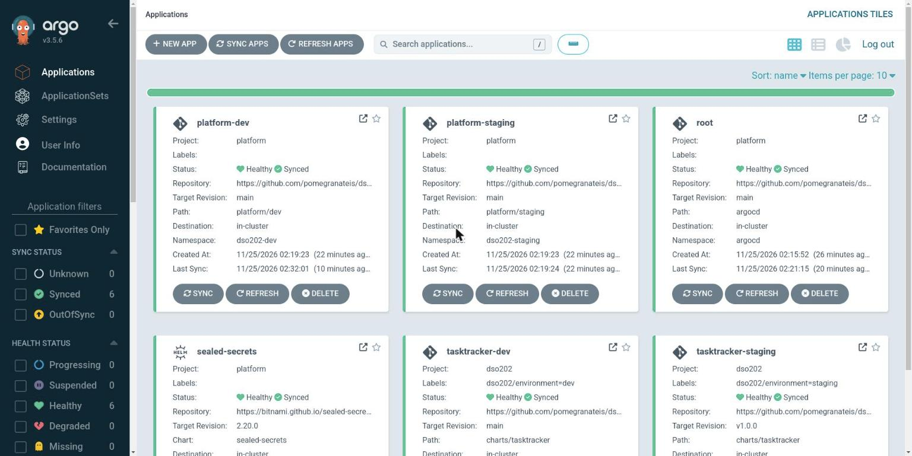

<!--
=============================================================================
File        : docs/evidence.md
Assignment  : DSO202 Assignment 4
Purpose     : Command output for every task, recorded as it was run
              (brief section 9, evidence convention). Passwords, the admin
              password and the sealing key are never recorded; where a command
              prints one, the output is replaced by a note.
=============================================================================
-->

# Evidence — DSO202 Assignment 4

Cluster `dso202-gitops` (kind, 1 control-plane + 2 workers, Kubernetes v1.36.1), repository
<https://github.com/pomegranateis/dso202-gitops>. Times are local (UTC+6). Screenshots are in
[`docs/screenshots/`](screenshots/) and are referenced from the task that requires them.

## Task 1 — Repository, Chart Contract and Cluster

### Tool check (section 3.2)
```text
$ docker version --format '{{.Server.Version}}'
28.0.1

$ kind version
kind v0.32.0 go1.26.3 linux/amd64

$ kubectl version --client
Client Version: v1.36.0
Kustomize Version: v5.8.1

$ helm version --short
v4.3.0+gbec5b06

$ git --version
git version 2.34.1

$ argocd version --client
argocd: v3.5.6
  BuildDate: 2026-10-20T18:33:20Z
  GitCommit: c2b1e3017e2cec86b122172e861dcd026453ae44
  GitTreeState: clean
  GitTag: v3.5.6
  GoVersion: go1.26.10
  Compiler: gc
  Platform: linux/amd64

$ kubeseal --version
kubeseal version: 0.40.0

$ helm repo add sealed-secrets https://bitnami.github.io/sealed-secrets
"sealed-secrets" already exists with the same configuration, skipping

$ helm repo update
Hang tight while we grab the latest from your chart repositories...
...Successfully got an update from the "kong" chart repository
...Successfully got an update from the "hashicorp" chart repository
...Successfully got an update from the "sealed-secrets" chart repository
...Successfully got an update from the "podinfo" chart repository
Update Complete. ⎈Happy Helming!⎈

$ helm search repo sealed-secrets/sealed-secrets --versions | head -5
NAME                         	CHART VERSION	APP VERSION	DESCRIPTION                                  
sealed-secrets/sealed-secrets	2.22.0       	0.41.2     	Helm chart for the sealed-secrets controller.
sealed-secrets/sealed-secrets	2.21.0       	0.41.2     	Helm chart for the sealed-secrets controller.
sealed-secrets/sealed-secrets	2.20.0       	0.40.0     	Helm chart for the sealed-secrets controller.
sealed-secrets/sealed-secrets	2.19.3       	0.39.1     	Helm chart for the sealed-secrets controller.
```

Chart `2.20.0` (controller `0.40.0`) is listed, as required.

### Chart contract

| # | Requirement | Where it is satisfied |
| --- | --- | --- |
| C1 | Image repository and tag are values per tier | `charts/tasktracker/values.yaml`: `database.image`, `backend.image`, `frontend.image` (`repository`, `tag`); template helper `tasktracker.image` in `templates/_helpers.tpl` reads only these |
| C2 | Per-tier configuration from values | `values.yaml`: `database.env`, `backend.env`, `frontend.env`; rendered by `tasktracker.envConfigMap` into `database-config`, `backend-config`, `frontend-config` (`templates/configmap.yaml`) |
| C3 | No `Secret`; credentials from `existingSecret` | `values.yaml`: `existingSecret: tasktracker-credentials`; `secretRef` in `templates/database.yaml` and `templates/backend.yaml`; `templates/secret.yaml` removed (commit `22180f7`) |
| C4 | Readiness probes on all tiers | `templates/database.yaml` (`pg_isready`), `templates/backend.yaml` (`GET /api/status`), `templates/frontend.yaml` (`GET /`) |
| C5 | Sync waves 0 / 1 / 2 | `argocd.argoproj.io/sync-wave` on `db-statefulset` (`"0"`), `backend-deployment` (`"1"`), `frontend-deployment` (`"2"`) |
| C6 | `progressDeadlineSeconds: 120` | `templates/backend.yaml`, `templates/frontend.yaml` |
| C7 | Requests and limits on every container | `values.yaml`: `<tier>.resources` (schema requires both); smoke-test Job in `templates/smoke-test-job.yaml` |
| C8 | No Namespace, ResourceQuota, LimitRange, Role, RoleBinding | `templates/quota.yaml` and `templates/rbac.yaml` removed (commit `22180f7`); those objects are in `platform/<env>/` |
| C9 | Ingress disabled by default | `values.yaml`: `ingress.enabled: false`; `templates/ingress.yaml` renders nothing unless enabled |
| C10 | Frontend `NodePort`, port as a value | `values.yaml`: `frontend.service.type: NodePort`; `environments/dev/values.yaml` `30080`, `environments/staging/values.yaml` `30081` |
| C11 | `helm lint` clean, `helm template` succeeds for both | output below |

The database tier is a StatefulSet (from Assignment 2) rather than the Deployment + PVC of Assignment 3, so that
the kinds rendered by the chart match the project whitelist (Task 3) without adding `PersistentVolumeClaim`.

### `helm lint` and the rendered kinds (step 6)

The kind list was rendered from commit `c5a965d`, i.e. before the smoke-test `Job` was added in Task 5.
```text
$ helm lint charts/tasktracker -f environments/dev/values.yaml
==> Linting charts/tasktracker
[INFO] Chart.yaml: icon is recommended

1 chart(s) linted, 0 chart(s) failed

$ helm lint charts/tasktracker -f environments/staging/values.yaml
==> Linting charts/tasktracker
[INFO] Chart.yaml: icon is recommended

1 chart(s) linted, 0 chart(s) failed

$ helm template tasktracker charts/tasktracker -f environments/dev/values.yaml | grep '^kind:' | sort | uniq -c
      3 kind: ConfigMap
      2 kind: Deployment
      3 kind: Service
      1 kind: StatefulSet
```

### Cluster (step 7)
```text
$ date
Mon Nov 23 03:50:30 PM +06 2026

$ kind get clusters
dso202

$ kind delete cluster --name dso202
Deleting cluster "dso202" ...
Deleted nodes: ["dso202-control-plane" "dso202-worker2" "dso202-worker"]

$ kind create cluster --name dso202-gitops --config cluster/kind-cluster.yaml
Creating cluster "dso202-gitops" ...
Set kubectl context to "kind-dso202-gitops"
You can now use your cluster with:

kubectl cluster-info --context kind-dso202-gitops

Have a nice day! 👋

$ kubectl config current-context
kind-dso202-gitops

$ kubectl wait --for=condition=Ready nodes --all --timeout=180s
node/control-plane condition met
node/worker-node-1 condition met
node/worker-node-2 condition met

$ kubectl get nodes
NAME            STATUS   ROLES           AGE   VERSION
control-plane   Ready    control-plane   23s   v1.36.1
worker-node-1   Ready    <none>          12s   v1.36.1
worker-node-2   Ready    <none>          12s   v1.36.1

$ docker ps --filter name=dso202-gitops --format '{{.Names}}   {{.Ports}}'
dso202-gitops-worker2   
dso202-gitops-worker   
dso202-gitops-control-plane   127.0.0.1:30080->30080/tcp, 127.0.0.1:33771->6443/tcp
```

Host port `30080` is mapped on `dso202-gitops-control-plane`, bound to `127.0.0.1`.

## Task 2 — Install Argo CD Declaratively

### Render checks (step 2)
```text
$ kubectl kustomize bootstrap/argocd | grep -E '^kind: (Deployment|StatefulSet)$' | sort | uniq -c
      6 kind: Deployment
      1 kind: StatefulSet

$ kubectl kustomize bootstrap/argocd | grep 'image:' | sort -u
        image: ghcr.io/dexidp/dex:v2.45.1
        image: public.ecr.aws/docker/library/redis:8.2.3-alpine
        image: quay.io/argoproj/argocd:v3.5.6
```

All 50 namespaced objects render in `argocd`; the ClusterRoleBinding subjects also name `argocd`.
No image comes from Docker Hub.

### Server-side apply and readiness (steps 3, 4, 6)

The `serverside-applied` lines (60 objects) are omitted.
```text
$ kubectl apply -k bootstrap/argocd --server-side --force-conflicts

$ kubectl wait --for=condition=Available deployment --all -n argocd --timeout=300s
deployment.apps/argocd-applicationset-controller condition met
deployment.apps/argocd-dex-server condition met
deployment.apps/argocd-notifications-controller condition met
deployment.apps/argocd-redis condition met
deployment.apps/argocd-repo-server condition met
deployment.apps/argocd-server condition met

$ kubectl rollout status statefulset/argocd-application-controller -n argocd --timeout=300s
partitioned roll out complete: 1 new pods have been updated...

$ kubectl get pods -n argocd
NAME                                                READY   STATUS    RESTARTS   AGE
argocd-application-controller-0                     1/1     Running   0          42s
argocd-applicationset-controller-58bb5c7479-k5q7n   1/1     Running   0          42s
argocd-dex-server-dd6b85d9c-bkmpb                   1/1     Running   0          42s
argocd-notifications-controller-6b85c65458-pbvdr    1/1     Running   0          42s
argocd-redis-869b85489d-f9fhz                       1/1     Running   0          42s
argocd-repo-server-5bf66565cd-jbbcg                 1/1     Running   0          42s
argocd-server-7474bb8f76-9jgvv                      1/1     Running   0          42s

$ kubectl get crd | grep argoproj.io
applications.argoproj.io      2026-11-24T20:13:55Z
applicationsets.argoproj.io   2026-11-24T20:13:55Z
appprojects.argoproj.io       2026-11-24T20:13:55Z

$ kubectl get configmap argocd-cm -n argocd -o yaml | grep -E 'timeout.reconciliation|accounts.reviewer'
  accounts.reviewer: login
  timeout.reconciliation: 60s
  timeout.reconciliation.jitter: 10s
```

### Sign-in and versions (steps 5, 6)
```text
$ argocd admin initial-password -n argocd
(output not recorded: it is the admin password)

$ argocd login localhost:8080 --username admin --insecure
'admin:login' logged in successfully
Context 'localhost:8080' updated

$ argocd version
argocd: v3.5.6
  BuildDate: 2026-10-20T18:33:20Z
  GitCommit: c2b1e3017e2cec86b122172e861dcd026453ae44
  GitTreeState: clean
  GitTag: v3.5.6
  GoVersion: go1.26.10
  Compiler: gc
  Platform: linux/amd64
argocd-server: v3.5.6
  BuildDate: 2026-10-20T18:33:20Z
  GitCommit: c2b1e3017e2cec86b122172e861dcd026453ae44
  GitTreeState: clean
  GitTag: v3.5.6
  GoVersion: go1.26.10
  Compiler: gc
  Platform: linux/amd64
  Kustomize Version: v5.8.1 2026-02-09T16:15:27Z
  Helm Version: v4.2.1+gd591a19
  Kubectl Version: v0.36.1
  Jsonnet Version: v0.22.0
```

The `argocd` CLI binary was copied from the official `quay.io/argoproj/argocd:v3.5.6` image
(`sha256:8e5cc5bb008df8a09dba439462e58c94c55b7735888d3ebde0c25fc05e4e5335`) because the
release download from GitHub kept stalling; `argocd version` above shows the same build
(`GitTag v3.5.6`, `GitCommit c2b1e30`, `GitTreeState clean`) for client and server.



## Task 3 — AppProjects and the Root Application

### Whitelist check (step 1)

The chart renders `ConfigMap`, `Deployment`, `Service`, `StatefulSet` and, from Task 5, the hook `Job`.
At this point `argocd/projects/dso202.yaml` listed exactly these five kinds. Compared with Listing 8,
`ServiceAccount` was removed (the chart renders none; the Assignment 2 ServiceAccount is in
`platform/<env>/rbac.yaml`), and `PersistentVolumeClaim` was not added (the database PVC comes from
`volumeClaimTemplates`). Each change is commented in the file. In Task 6, `ReplicaSet` and `Pod` were added
so that Argo CD shows the Pods and their logs (see Task 6).

### Apply and observe (steps 4, 5)
```text
$ kubectl apply -f bootstrap/root
appproject.argoproj.io/platform created
Warning: metadata.finalizers: "resources-finalizer.argocd.argoproj.io": prefer a domain-qualified finalizer name including a path (/) to avoid accidental conflicts with other finalizer writers
application.argoproj.io/root created
```
```text
$ kubectl get appproject,application -n argocd
NAME                              AGE
appproject.argoproj.io/default    110s
appproject.argoproj.io/dso202     2s
appproject.argoproj.io/platform   5s

NAME                           SYNC STATUS   HEALTH STATUS
application.argoproj.io/root   Synced        Healthy

$ argocd app get root
Name:               argocd/root
Project:            platform
Server:             https://kubernetes.default.svc
Namespace:          argocd
URL:                https://localhost:8080/applications/root
Source:
- Repo:             https://github.com/pomegranateis/dso202-gitops.git
  Target:           main
  Path:             argocd
SyncWindow:         Sync Allowed
Sync Policy:        Automated (Prune)
Sync Status:        Synced to main (c3741ce)
Health Status:      Healthy

GROUP        KIND        NAMESPACE  NAME    STATUS  HEALTH  HOOK  MESSAGE
argoproj.io  AppProject  argocd     dso202  Synced                appproject.argoproj.io/dso202 unchanged

$ argocd proj get dso202
Name:                        dso202
Description:                 Task Tracker workloads for the dev and staging environments
Destinations:                https://kubernetes.default.svc,dso202-dev
                             https://kubernetes.default.svc,dso202-staging
Repositories:                https://github.com/pomegranateis/dso202-gitops.git
Source Namespaces:           <none>
Scoped Repositories:         <none>
Allowed Cluster Resources:   <none>
Scoped Clusters:             <none>
Denied Namespaced Resources: <none>
Signature keys:              <none>
Orphaned Resources:          disabled
```

`dso202` was created by the root Application: it appears in the resource list of `argocd app get root`,
and it is three seconds younger than `platform`, which was applied by hand.


## Task 4 — Platform Layer and Sealed Secrets

### Controller installed through Git (step 1)

Commit `497bfcc` added `argocd/applications/sealed-secrets.yaml`.
```text
$ kubectl get applications -n argocd
NAME             SYNC STATUS   HEALTH STATUS
root             Synced        Healthy
sealed-secrets   Synced        Healthy

$ kubectl get pods -n sealed-secrets
NAME                                        READY   STATUS    RESTARTS   AGE
sealed-secrets-controller-8b5ffdf69-2bfvk   1/1     Running   0          15s

$ kubectl get crd sealedsecrets.bitnami.com
NAME                        CREATED AT
sealedsecrets.bitnami.com   2026-11-24T20:16:22Z
```

### Sealing-key backup (step 2)

The backup's contents are never shown.
```text
$ mkdir -p ../dso202-keys
$ kubectl get secret -n sealed-secrets -l sealedsecrets.bitnami.com/sealed-secrets-key -o yaml > ../dso202-keys/sealing-key.backup.yaml
$ chmod 600 ../dso202-keys/sealing-key.backup.yaml
$ ls -l ../dso202-keys/
-rw------- 1 pomegranateu pomegranateu 7087 Nov 25 02:17 sealing-key.backup.yaml
$ kubectl get secret -n sealed-secrets -l sealedsecrets.bitnami.com/sealed-secrets-key
NAME                      TYPE                DATA   AGE
sealed-secrets-key49h67   kubernetes.io/tls   2      41s
```

### Sealing (steps 3, 4)

`secrets-plain/dev.env` and `secrets-plain/staging.env` (git-ignored, mode `600`) held different passwords
for dev and staging, with `DB_*` and `POSTGRES_*` carrying the same values. Each was sealed for its own
namespace with the pipeline of step 4; the output files are
`platform/dev/tasktracker-credentials.sealed.yaml` and `platform/staging/tasktracker-credentials.sealed.yaml`.
After sealing, the plaintext inputs were deleted and the values kept outside the repository.

The first history search (step 7) found the database **user name** `taskuser`: it entered the repository with
the unchanged Assignment 3 chart import (`84fcd3e`, `values.yaml` `credentials.username`) and had already been
removed from the chart in `d30935c`. Because history is permanent, both environments were re-sealed with user
names that had never appeared in Git (commit `3c670f8`, "Re-seal credentials with database usernames that never
appeared in Git history"). The passwords had never been committed and were kept.

### Delivered platform layer (step 6)
```text
$ kubectl get applications -n argocd
NAME               SYNC STATUS   HEALTH STATUS
platform-dev       Synced        Healthy
platform-staging   Synced        Healthy
root               Synced        Healthy
sealed-secrets     Synced        Healthy

$ kubectl get namespaces | grep dso202
dso202-dev           Active   12s
dso202-staging       Active   12s

$ kubectl get sealedsecret -n dso202-dev
NAME                      STATUS   SYNCED   AGE
tasktracker-credentials            True     11s

$ kubectl get sealedsecret -n dso202-staging
NAME                      STATUS   SYNCED   AGE
tasktracker-credentials            True     11s

$ kubectl describe secret tasktracker-credentials -n dso202-dev
Name:         tasktracker-credentials
Namespace:    dso202-dev
Labels:       <none>
Annotations:  <none>

Type:  Opaque

Data
====
DB_PASSWORD:        24 bytes
DB_USER:            9 bytes
POSTGRES_PASSWORD:  24 bytes
POSTGRES_USER:      9 bytes

$ kubectl describe secret tasktracker-credentials -n dso202-staging
Name:         tasktracker-credentials
Namespace:    dso202-staging
Labels:       <none>
Annotations:  <none>

Type:  Opaque

Data
====
DB_PASSWORD:        24 bytes
DB_USER:            13 bytes
POSTGRES_PASSWORD:  24 bytes
POSTGRES_USER:      13 bytes

$ kubectl get resourcequota,limitrange -n dso202-dev
NAME                             REQUEST                                                        LIMIT                                   AGE
resourcequota/assignment-quota   pods: 0/10, requests.cpu: 0/1500m, requests.memory: 0/1536Mi   limits.cpu: 0/3, limits.memory: 0/3Gi   11s

NAME                               CREATED AT
limitrange/assignment-limitrange   2026-11-24T20:19:24Z

$ kubectl get resourcequota,limitrange -n dso202-staging
NAME                             REQUEST                                                        LIMIT                                   AGE
resourcequota/assignment-quota   pods: 0/10, requests.cpu: 0/1500m, requests.memory: 0/1536Mi   limits.cpu: 0/3, limits.memory: 0/3Gi   12s

NAME                               CREATED AT
limitrange/assignment-limitrange   2026-11-24T20:19:24Z

$ kubectl get role,rolebinding,serviceaccount readonly-viewer -n dso202-dev 2>/dev/null
NAME              AGE
readonly-viewer   11s
NAME                                           CREATED AT
role.rbac.authorization.k8s.io/readonly-role   2026-11-24T20:19:24Z

NAME                                                     ROLE                 AGE
rolebinding.rbac.authorization.k8s.io/readonly-binding   Role/readonly-role   11s

$ kubectl get secret tasktracker-credentials -n dso202-dev -o jsonpath='{.metadata.ownerReferences[0].kind}/{.metadata.ownerReferences[0].name}'
SealedSecret/tasktracker-credentials
```

### No plaintext in Git (step 7)

Tested keys: `DB_USER` and `DB_PASSWORD` for dev and for staging, and the base64 encoding of each password.
`POSTGRES_USER` and `POSTGRES_PASSWORD` carry the same values, so they are covered.
```text
# For each distinct credential value, the whole history (all refs) is searched. Values are read from secrets-plain/ inside the command and never printed.
$ git log -p --all -S'<dev DB_USER value>' | head
(no output)

$ git log -p --all -S'<dev DB_PASSWORD value>' | head
(no output)

$ git log -p --all -S'<base64 of dev DB_PASSWORD>' | head
(no output)

$ git log -p --all -S'<staging DB_USER value>' | head
(no output)

$ git log -p --all -S'<staging DB_PASSWORD value>' | head
(no output)

$ git log -p --all -S'<base64 of staging DB_PASSWORD>' | head
(no output)

# POSTGRES_USER and POSTGRES_PASSWORD carry the same values as DB_USER and DB_PASSWORD, so the searches above cover all four keys.

$ git status --short --ignored
!! secrets-plain/
```

## Task 5 — Deliver the Workloads to dev and staging

Commit `740cfb5` added the smoke-test Job (Listing 13) and is tagged `v1.0.0`; commit `bafe41d` added the two
Applications. The smoke test's resources were raised from Listing 13's `10m/16Mi` to `50m/64Mi`: the
Assignment 2 LimitRange sets that minimum, and a server-side dry run of the listing's values was rejected with
`minimum cpu usage per Container is 50m, but request is 10m, minimum memory usage per Container is 64Mi, but request is 16Mi`.

### Wave order in dev (step 4)

`kubectl get pods -n dso202-dev -w --output-watch-events`, first line per Pod, readiness and status, with the local time:
```text
02:21:16 ADDED db-statefulset-0 0/1 Pending
02:21:20 MODIFIED db-statefulset-0 0/1 ContainerCreating
02:21:20 MODIFIED db-statefulset-0 0/1 Running
02:21:41 MODIFIED db-statefulset-0 1/1 Running
02:21:41 ADDED backend-deployment-6cbf846f89-c4h5c 0/1 Pending
02:21:41 MODIFIED backend-deployment-6cbf846f89-c4h5c 0/1 ContainerCreating
02:21:42 MODIFIED backend-deployment-6cbf846f89-c4h5c 0/1 Running
02:21:53 MODIFIED backend-deployment-6cbf846f89-c4h5c 1/1 Running
02:21:53 ADDED frontend-deployment-84f799988-hwv8n 0/1 Pending
02:21:53 MODIFIED frontend-deployment-84f799988-hwv8n 0/1 ContainerCreating
02:21:54 MODIFIED frontend-deployment-84f799988-hwv8n 0/1 Running
02:22:00 MODIFIED frontend-deployment-84f799988-hwv8n 1/1 Running
02:22:00 ADDED tasktracker-smoke-test-plh4v 0/1 Pending
02:22:00 MODIFIED tasktracker-smoke-test-plh4v 0/1 ContainerCreating
02:22:03 MODIFIED tasktracker-smoke-test-plh4v 1/1 Running
02:22:04 MODIFIED tasktracker-smoke-test-plh4v 0/1 Completed
02:27:51 ADDED backend-deployment-6cbf846f89-qmcgd 0/1 Pending
02:27:51 ADDED backend-deployment-6cbf846f89-m64x9 0/1 Pending
02:27:51 MODIFIED backend-deployment-6cbf846f89-qmcgd 0/1 ContainerCreating
02:27:51 MODIFIED backend-deployment-6cbf846f89-m64x9 0/1 ContainerCreating
02:27:51 MODIFIED backend-deployment-6cbf846f89-m64x9 0/1 Running
02:27:51 MODIFIED backend-deployment-6cbf846f89-qmcgd 0/1 Running
02:27:56 MODIFIED backend-deployment-6cbf846f89-qmcgd 0/1 Terminating
02:27:56 MODIFIED backend-deployment-6cbf846f89-m64x9 0/1 Terminating
02:27:56 MODIFIED backend-deployment-6cbf846f89-m64x9 0/1 Error
02:27:56 MODIFIED backend-deployment-6cbf846f89-qmcgd 0/1 Error
02:28:00 ADDED tasktracker-smoke-test-kbm8t 0/1 Pending
02:28:00 MODIFIED tasktracker-smoke-test-kbm8t 0/1 ContainerCreating
02:28:04 MODIFIED tasktracker-smoke-test-kbm8t 1/1 Running
02:28:04 MODIFIED tasktracker-smoke-test-kbm8t 0/1 Completed
02:41:23 ADDED tasktracker-smoke-test-926bq 0/1 Pending
02:41:23 MODIFIED tasktracker-smoke-test-926bq 0/1 ContainerCreating
02:41:26 MODIFIED tasktracker-smoke-test-926bq 1/1 Running
02:41:27 MODIFIED tasktracker-smoke-test-926bq 0/1 Completed
```

Each tier was created in the same second the previous one became ready: the database became ready (`1/1`) at
02:21:41 and the backend Pod was created at 02:21:41; the backend became ready at 02:21:53 and the frontend was
created at 02:21:53; the frontend became ready at 02:22:00 and the PostSync smoke test was created at 02:22:00 and
completed at 02:22:04. Argo CD waited for each wave to be Healthy before applying the next.
```text
$ kubectl get job -n dso202-dev
NAME                     STATUS     COMPLETIONS   DURATION   AGE
tasktracker-smoke-test   Complete   1/1           6s         19s

$ kubectl logs job/tasktracker-smoke-test -n dso202-dev
[{"id":1,"title":"Set up kind cluster","description":"Bring up the local cluster from Practical 1","status":"done","created_at":"2026-11-24T20:21:38.190Z"},{"id":2,"title":"Write namespace manifest","description":"One namespace for all assignment resources","status":"in_progress","created_at":"2026-11-24T20:21:38.190Z"},{"id":3,"title":"Wire ConfigMap and Secret","description":"DB_* and POSTGRES_* must carry matching values","status":"pending","created_at":"2026-11-24T20:21:38.190Z"}]

$ argocd app get tasktracker-dev
Name:               argocd/tasktracker-dev
Project:            dso202
Server:             https://kubernetes.default.svc
Namespace:          dso202-dev
URL:                https://localhost:8080/applications/tasktracker-dev
Source:
- Repo:             https://github.com/pomegranateis/dso202-gitops.git
  Target:           main
  Path:             charts/tasktracker
  Helm Values:      ../../environments/dev/values.yaml
SyncWindow:         Sync Allowed
Sync Policy:        Automated (Prune)
Sync Status:        Synced to main (bafe41d)
Health Status:      Healthy

GROUP  KIND         NAMESPACE   NAME                    STATUS     HEALTH   HOOK      MESSAGE
       ConfigMap    dso202-dev  frontend-config         Synced                        configmap/frontend-config created
       ConfigMap    dso202-dev  backend-config          Synced                        configmap/backend-config created
       ConfigMap    dso202-dev  database-config         Synced                        configmap/database-config created
       Service      dso202-dev  db-svc                  Synced     Healthy            service/db-svc created
       Service      dso202-dev  frontend-svc            Synced     Healthy            service/frontend-svc created
       Service      dso202-dev  backend-svc             Synced     Healthy            service/backend-svc created
apps   StatefulSet  dso202-dev  db-statefulset          Synced     Healthy            statefulset rolling update complete 1 pods at revision db-statefulset-6d7bbcddb4...
apps   Deployment   dso202-dev  backend-deployment      Synced     Healthy            deployment.apps/backend-deployment created
apps   Deployment   dso202-dev  frontend-deployment     Synced     Healthy            deployment.apps/frontend-deployment created
batch  Job          dso202-dev  tasktracker-smoke-test  Succeeded  Synced   PostSync  Reached expected number of succeeded pods

$ argocd app get tasktracker-staging
Name:               argocd/tasktracker-staging
Project:            dso202
Server:             https://kubernetes.default.svc
Namespace:          dso202-staging
URL:                https://localhost:8080/applications/tasktracker-staging
Source:
- Repo:             https://github.com/pomegranateis/dso202-gitops.git
  Target:           v1.0.0
  Path:             charts/tasktracker
  Helm Values:      ../../environments/staging/values.yaml
SyncWindow:         Sync Allowed
Sync Policy:        Manual
Sync Status:        OutOfSync from v1.0.0 (740cfb5)
Health Status:      Missing

GROUP  KIND         NAMESPACE       NAME                 STATUS     HEALTH   HOOK  MESSAGE
       ConfigMap    dso202-staging  backend-config       OutOfSync  Missing        
       ConfigMap    dso202-staging  database-config      OutOfSync  Missing        
       ConfigMap    dso202-staging  frontend-config      OutOfSync  Missing        
       Service      dso202-staging  backend-svc          OutOfSync  Missing        
       Service      dso202-staging  db-svc               OutOfSync  Missing        
       Service      dso202-staging  frontend-svc         OutOfSync  Missing        
apps   Deployment   dso202-staging  backend-deployment   OutOfSync  Missing        
apps   Deployment   dso202-staging  frontend-deployment  OutOfSync  Missing        
apps   StatefulSet  dso202-staging  db-statefulset       OutOfSync  Missing        

# root BEFORE the first staging sync
$ argocd app get root --refresh
Name:               argocd/root
Project:            platform
Server:             https://kubernetes.default.svc
Namespace:          argocd
URL:                https://localhost:8080/applications/root
Source:
- Repo:             https://github.com/pomegranateis/dso202-gitops.git
  Target:           main
  Path:             argocd
SyncWindow:         Sync Allowed
Sync Policy:        Automated (Prune)
Sync Status:        Synced to main (bafe41d)
Health Status:      Healthy

GROUP        KIND         NAMESPACE  NAME                 STATUS  HEALTH   HOOK  MESSAGE
argoproj.io  Application  argocd     tasktracker-staging  Synced  Missing        application.argoproj.io/tasktracker-staging unchanged
argoproj.io  Application  argocd     tasktracker-dev      Synced  Healthy        application.argoproj.io/tasktracker-dev unchanged
argoproj.io  AppProject   argocd     dso202               Synced                 
argoproj.io  Application  argocd     platform-dev         Synced  Healthy        
argoproj.io  Application  argocd     platform-staging     Synced  Healthy        
argoproj.io  Application  argocd     sealed-secrets       Synced  Healthy
```


The screenshot was taken after the Task 6 whitelist change; before it, the tree showed the same objects without the ReplicaSet and Pod nodes.

### CRUD cycle in dev (step 4)

The dev frontend is at `http://localhost:30080`. The browser calls the API at `BACKEND_URL`
(`http://localhost:8090`, set in `environments/dev/values.yaml`), reached with
`kubectl -n dso202-dev port-forward svc/backend-svc 8090:8080`.
```text
$ curl -s -o /dev/null -w 'frontend: HTTP %{http_code}\n' http://localhost:30080/
frontend: HTTP 200


$ curl -s http://localhost:30080/config.js | grep BACKEND_URL
  BACKEND_URL: "http://localhost:8090"


$ curl -s http://localhost:8090/api/status
{"status":"ok","db":"connected"}

# CREATE
$ curl -s -X POST -H 'Content-Type: application/json' -d '{"title":"GitOps CRUD check","description":"created through the dev backend"}' http://localhost:8090/api/tasks
{"id":4,"title":"GitOps CRUD check","description":"created through the dev backend","status":"pending","created_at":"2026-11-24T20:22:42.022Z"}

# READ
$ curl -s http://localhost:8090/api/tasks/4
{"id":4,"title":"GitOps CRUD check","description":"created through the dev backend","status":"pending","created_at":"2026-11-24T20:22:42.022Z"}

# UPDATE
$ curl -s -X PUT -H 'Content-Type: application/json' -d '{"title":"GitOps CRUD check","description":"created through the dev backend","status":"done"}' http://localhost:8090/api/tasks/4
{"id":4,"title":"GitOps CRUD check","description":"created through the dev backend","status":"done","created_at":"2026-11-24T20:22:42.022Z"}

# DELETE
$ curl -s -o /dev/null -w 'HTTP %{http_code}\n' -X DELETE http://localhost:8090/api/tasks/4
HTTP 204


$ curl -s -o /dev/null -w 'HTTP %{http_code}\n' http://localhost:8090/api/tasks/4
HTTP 404
```


### Staging, synchronised by hand (step 5)

Before the sync, `tasktracker-staging` was `OutOfSync` / `Missing` (see `argocd app get tasktracker-staging` above).
Root state **before** the first staging sync: `Synced` / `Healthy` (output above). The brief expects the root not
to be `Healthy` at this point; in Argo CD v3.5.6 the parent's health does not take a child's `Missing` status into
account (the child is reported through its sync status instead), so the root stayed `Healthy`.
```text
$ argocd app sync tasktracker-staging
2026-11-25T02:22:48+06:00   apps  StatefulSet  dso202-staging        db-statefulset  OutOfSync  Missing
2026-11-25T02:22:48+06:00          ConfigMap   dso202-staging        backend-config  OutOfSync  Missing
2026-11-25T02:22:48+06:00          ConfigMap   dso202-staging       database-config  OutOfSync  Missing
2026-11-25T02:22:48+06:00          ConfigMap   dso202-staging       frontend-config  OutOfSync  Missing
2026-11-25T02:22:48+06:00            Service   dso202-staging           backend-svc  OutOfSync  Missing
2026-11-25T02:22:48+06:00            Service   dso202-staging                db-svc  OutOfSync  Missing
2026-11-25T02:22:48+06:00            Service   dso202-staging          frontend-svc  OutOfSync  Missing
2026-11-25T02:22:48+06:00   apps  Deployment   dso202-staging    backend-deployment  OutOfSync  Missing
2026-11-25T02:22:48+06:00   apps  Deployment   dso202-staging   frontend-deployment  OutOfSync  Missing
2026-11-25T02:22:48+06:00          ConfigMap  dso202-staging       database-config    Synced  Missing
2026-11-25T02:22:48+06:00          ConfigMap  dso202-staging        backend-config    Synced  Missing
2026-11-25T02:22:48+06:00          ConfigMap  dso202-staging       frontend-config    Synced  Missing
2026-11-25T02:22:48+06:00            Service   dso202-staging           backend-svc    Synced  Healthy
2026-11-25T02:22:48+06:00            Service   dso202-staging                db-svc    Synced  Healthy
2026-11-25T02:22:48+06:00            Service   dso202-staging          frontend-svc    Synced  Healthy
2026-11-25T02:22:48+06:00   apps  StatefulSet  dso202-staging        db-statefulset    Synced  Progressing
2026-11-25T02:22:50+06:00          ConfigMap   dso202-staging        backend-config    Synced  Missing                  configmap/backend-config created
2026-11-25T02:22:50+06:00            Service   dso202-staging                db-svc    Synced  Healthy                  service/db-svc created
2026-11-25T02:22:50+06:00            Service   dso202-staging           backend-svc    Synced  Healthy                  service/backend-svc created
2026-11-25T02:22:50+06:00          ConfigMap   dso202-staging       frontend-config    Synced  Missing                  configmap/frontend-config created
2026-11-25T02:22:50+06:00          ConfigMap   dso202-staging       database-config    Synced  Missing                  configmap/database-config created
2026-11-25T02:22:50+06:00            Service   dso202-staging          frontend-svc    Synced  Healthy                  service/frontend-svc created
2026-11-25T02:22:50+06:00   apps  StatefulSet  dso202-staging        db-statefulset    Synced  Progressing              statefulset.apps/db-statefulset created
2026-11-25T02:23:14+06:00   apps  StatefulSet  dso202-staging        db-statefulset    Synced  Healthy              statefulset.apps/db-statefulset created
2026-11-25T02:23:14+06:00   apps  Deployment  dso202-staging    backend-deployment    Synced  Progressing
2026-11-25T02:23:16+06:00   apps  Deployment   dso202-staging    backend-deployment    Synced  Progressing              deployment.apps/backend-deployment created
2026-11-25T02:23:16+06:00   apps  StatefulSet  dso202-staging        db-statefulset    Synced  Healthy                  statefulset rolling update complete 1 pods at revision db-statefulset-7cd7bb74f5...
2026-11-25T02:23:26+06:00   apps  Deployment  dso202-staging    backend-deployment    Synced  Healthy              deployment.apps/backend-deployment created
2026-11-25T02:23:26+06:00   apps  Deployment  dso202-staging   frontend-deployment    Synced  Progressing
2026-11-25T02:23:28+06:00   apps  Deployment  dso202-staging   frontend-deployment    Synced  Progressing              deployment.apps/frontend-deployment created
2026-11-25T02:23:32+06:00   apps  Deployment  dso202-staging   frontend-deployment    Synced  Healthy              deployment.apps/frontend-deployment created
2026-11-25T02:23:32+06:00  batch         Job  dso202-staging  tasktracker-smoke-test   Running   Synced    PostSync  job.batch/tasktracker-smoke-test created
2026-11-25T02:23:38+06:00  batch         Job  dso202-staging  tasktracker-smoke-test  Succeeded   Synced    PostSync  Reached expected number of succeeded pods
Name:               argocd/tasktracker-staging
Project:            dso202
Sync Status:        Synced to v1.0.0 (740cfb5)
Health Status:      Healthy
Operation:          Sync
Sync Revision:      740cfb5e356505b96d0b972860ffa021daa8a89d
Phase:              Succeeded
Start:              2026-11-25 02:22:48 +0600 +06
Finished:           2026-11-25 02:23:38 +0600 +06
Duration:           50s
Message:            successfully synced (no more tasks)
```

Root and staging **after** the first staging sync:
```text
# root AFTER the first staging sync
$ argocd app get root --refresh
Sync Status:        Synced to main (bafe41d)
Health Status:      Healthy

GROUP        KIND         NAMESPACE  NAME                 STATUS  HEALTH   HOOK  MESSAGE
argoproj.io  Application  argocd     tasktracker-staging  Synced  Healthy        application.argoproj.io/tasktracker-staging unchanged
argoproj.io  Application  argocd     tasktracker-dev      Synced  Healthy        application.argoproj.io/tasktracker-dev unchanged
argoproj.io  AppProject   argocd     dso202               Synced                 
argoproj.io  Application  argocd     platform-dev         Synced  Healthy        
argoproj.io  Application  argocd     platform-staging     Synced  Healthy        
argoproj.io  Application  argocd     sealed-secrets       Synced  Healthy        

$ kubectl get applications -n argocd
NAME                  SYNC STATUS   HEALTH STATUS
platform-dev          Synced        Healthy
platform-staging      Synced        Healthy
root                  Synced        Healthy
sealed-secrets        Synced        Healthy
tasktracker-dev       Synced        Healthy
tasktracker-staging   Synced        Healthy

$ kubectl get svc -n dso202-staging
NAME           TYPE        CLUSTER-IP      EXTERNAL-IP   PORT(S)          AGE
backend-svc    ClusterIP   10.96.220.229   <none>        8080/TCP         65s
db-svc         ClusterIP   None            <none>        5432/TCP         65s
frontend-svc   NodePort    10.96.223.40    <none>        8080:30081/TCP   65s

$ kubectl port-forward -n dso202-staging svc/frontend-svc 8081:8080   (and svc/backend-svc 8091:8080)

$ curl -s -o /dev/null -w 'staging frontend: HTTP %{http_code}\n' http://localhost:8081/
staging frontend: HTTP 200
$ curl -s http://localhost:8081/config.js | grep BACKEND_URL
  BACKEND_URL: "http://localhost:8091"
$ curl -s http://localhost:8091/api/status
{"status":"ok","db":"connected"}

$ kubectl logs job/tasktracker-smoke-test -n dso202-staging
[{"id":1,"title":"Set up kind cluster","description":"Bring up the local cluster from Practical 1","status":"done","crea
```


## Task 6 — Access Control for Argo CD Users

### Account, password, and the three permission states (steps 1-3)

Both passwords are read from files outside the repository and are not recorded.
```text
$ argocd account list
NAME      ENABLED  CAPABILITIES
admin     true     login
reviewer  true     login

$ argocd account update-password --account reviewer
(prompts answered from files outside the repository; neither password is recorded)
Password updated

$ argocd login localhost:8080 --username reviewer --insecure --name reviewer
'reviewer:login' logged in successfully
Context 'reviewer' updated

$ argocd --argocd-context reviewer app list
NAME                        CLUSTER                         NAMESPACE       PROJECT  STATUS  HEALTH   SYNCPOLICY  CONDITIONS  REPO                                                PATH                TARGET
argocd/tasktracker-dev      https://kubernetes.default.svc  dso202-dev      dso202   Synced  Healthy  Auto-Prune  <none>      https://github.com/pomegranateis/dso202-gitops.git  charts/tasktracker  main
argocd/tasktracker-staging  https://kubernetes.default.svc  dso202-staging  dso202   Synced  Healthy  Manual      <none>      https://github.com/pomegranateis/dso202-gitops.git  charts/tasktracker  v1.0.0

$ argocd --argocd-context reviewer account can-i get applications 'dso202/tasktracker-dev'
yes

$ argocd --argocd-context reviewer account can-i sync applications 'dso202/tasktracker-dev'
no

$ argocd --argocd-context reviewer account can-i get logs 'dso202/tasktracker-dev'
no

$ argocd --argocd-context reviewer proj get platform
{"level":"fatal","msg":"rpc error: code = PermissionDenied desc = permission denied: projects, get, platform, sub: reviewer, iat: 2026-11-24T20:24:11Z","time":"2026-11-25T02:24:11+06:00"}
```

### Log access granted by commit (step 4)

Commit `9df8c1c` enabled `p, reviewer, logs, get, dso202/*, allow` in `bootstrap/argocd/argocd-rbac-cm-patch.yaml`.
The bootstrap layer is not managed by the root Application, so the change was applied by re-running the
bootstrap command.
```text
$ kubectl apply -k bootstrap/argocd --server-side --force-conflicts
(all other objects: serverside-applied, unchanged in content)

$ argocd --argocd-context reviewer account can-i get logs 'dso202/tasktracker-dev'
yes

$ argocd --argocd-context reviewer account can-i get logs 'platform/platform-dev'
no

$ argocd --argocd-context reviewer account can-i sync applications 'dso202/tasktracker-dev'
no

$ kubectl get configmap argocd-rbac-cm -n argocd -o jsonpath={.data.policy\.csv} | grep "^ *p,"
p, reviewer, applications, get, dso202/*, allow
p, reviewer, projects, get, dso202, allow
p, reviewer, logs, get, dso202/*, allow

$ argocd context localhost:8080   (step 5: back to the admin session)
Already at context 'localhost:8080'
CURRENT  NAME            SERVER
*        localhost:8080  localhost:8080
         reviewer        localhost:8080
```

### Pods were not visible, so no logs could be served

With the log rule in place, the reviewer's UI and `argocd app logs` still returned no log lines, and the same
command as `admin` also returned nothing. `argocd app get tasktracker-dev -o tree` showed the Deployments,
StatefulSet and Job but none of their ReplicaSets or Pods, while `sealed-secrets` (in the unrestricted
`platform` project) showed `Deployment -> ReplicaSet -> Pod`. Argo CD leaves kinds that the project does not
permit out of an Application's resource tree, and it serves logs only for Pods in that tree. Commit `d270fd2`
added `ReplicaSet` and `Pod` to the `dso202` whitelist, with a comment. This does not let a commit do anything
new in practice: a `Deployment` is already permitted and can run any Pod.
```text
```text
# Before the change (whitelist without ReplicaSet and Pod):
$ argocd app get tasktracker-dev -o tree   -> Deployment/StatefulSet/Job only; no ReplicaSet or Pod nodes
$ argocd --argocd-context reviewer app logs tasktracker-dev --kind Deployment --name backend-deployment --tail 3
(no output; the same command as admin also printed nothing)
$ argocd app get sealed-secrets -o tree   (platform project, all kinds permitted) | grep -E "Deployment|ReplicaSet|Pod"
Deployment/sealed-secrets-controller                   Synced  Healthy  deployment.apps/sealed-secrets-controller created
└─ReplicaSet/sealed-secrets-controller-8b5ffdf69               Healthy  
  └─Pod/sealed-secrets-controller-8b5ffdf69-2bfvk              Healthy  

# After commit d270fd2 (ReplicaSet and Pod added to the dso202 whitelist):
$ argocd app get tasktracker-dev -o tree | grep -E "Deployment|StatefulSet|ReplicaSet|Pod|Job"
Deployment/backend-deployment                Synced     Healthy  deployment.apps/backend-deployment unchanged
└─ReplicaSet/backend-deployment-6cbf846f89              Healthy  
  └─Pod/backend-deployment-6cbf846f89-c4h5c             Healthy  
Deployment/frontend-deployment               Synced     Healthy  deployment.apps/frontend-deployment unchanged
└─ReplicaSet/frontend-deployment-84f799988              Healthy  
  └─Pod/frontend-deployment-84f799988-hwv8n             Healthy  
StatefulSet/db-statefulset                   Synced     Healthy  statefulset rolling update complete 1 pods at revision db-statefulset-6d7bbcddb4...
└─Pod/db-statefulset-0                                  Healthy  
Job/tasktracker-smoke-test                   Succeeded  Synced   Reached expected number of succeeded pods
└─Pod/tasktracker-smoke-test-926bq                      Healthy  

$ argocd --argocd-context reviewer app logs tasktracker-dev --kind Deployment --name backend-deployment --tail 3
[db] connected
[server] listening on :8080
$ argocd --argocd-context reviewer account can-i get logs 'platform/platform-dev'
no
```
```

### Reviewer session in the UI

The browser was signed out of the `admin` session and signed in as `reviewer` (a separate session, in place of a
private window). The reviewer sees only the two `dso202` Applications and can read Pod logs. The log viewer's
*follow* mode streams through the `kubectl port-forward`, which kept dropping the stream; with *follow* turned
off the viewer fetched the log once.


## Task 7 — A Release, a Faulty Release, and Recovery

_Pending: the release images `frontend:1.1` and `backend:1.1` have not been issued by the module tutor yet (the
tutor's Docker Hub repositories contain only tag `1.0`). Task 8 was therefore performed before Task 7; its drills
do not depend on the state left by Task 7._

## Task 8 — Drift, Pruning and Project Guardrails

Each prediction was written before the action. Times are local.

### Drill 1 - drift in dev is reverted

**Prediction** (written 02:27:48, before running anything): Scaling the dev backend to 3 by hand makes the live state differ from Git (replicas: 1). Because tasktracker-dev has selfHeal: true, Argo CD will detect the drift within seconds and scale it back to 1; the extra Pods will be created and then terminated.

```text
$ kubectl get deployment -n dso202-dev
NAME                  READY   UP-TO-DATE   AVAILABLE   AGE
backend-deployment    1/1     1            1           6m7s
frontend-deployment   1/1     1            1           5m55s

$ kubectl get deployment/backend-deployment -n dso202-dev -w    (started before the change; timestamps added)
02:27:51 $ kubectl scale deployment/backend-deployment -n dso202-dev --replicas=3
deployment.apps/backend-deployment scaled
02:27:48 NAME                 READY   UP-TO-DATE   AVAILABLE   AGE
02:27:48 backend-deployment   1/1     1            1           6m7s
02:27:51 backend-deployment   1/3     1            1           6m10s
02:27:51 backend-deployment   1/3     1            1           6m10s
02:27:51 backend-deployment   1/3     1            1           6m10s
02:27:51 backend-deployment   1/3     3            1           6m10s
02:27:56 backend-deployment   1/1     3            1           6m15s
02:27:56 backend-deployment   1/1     3            1           6m15s
02:27:56 backend-deployment   1/1     3            1           6m15s
02:27:56 backend-deployment   1/1     1            1           6m15s
02:27:56 backend-deployment   1/1     1            1           6m15s
02:27:56 backend-deployment   1/1     1            1           6m15s

$ kubectl get events -n argocd --field-selector involvedObject.name=tasktracker-dev --sort-by=.lastTimestamp | tail -6
33s         Normal   OperationStarted     application/tasktracker-dev   Initiated automated sync to '9df8c1c9d783327d25c17e749ba4a3deb005a520'
33s         Normal   ResourceUpdated      application/tasktracker-dev   Updated sync status: Synced -> OutOfSync
33s         Normal   ResourceUpdated      application/tasktracker-dev   Updated health status: Healthy -> Progressing
31s         Normal   ResourceUpdated      application/tasktracker-dev   Updated sync status: OutOfSync -> Synced
31s         Normal   ResourceUpdated      application/tasktracker-dev   Updated health status: Progressing -> Healthy
21s         Normal   OperationCompleted   application/tasktracker-dev   Sync operation to 9df8c1c9d783327d25c17e749ba4a3deb005a520 succeeded

$ kubectl get deployment/backend-deployment -n dso202-dev
NAME                 READY   UP-TO-DATE   AVAILABLE   AGE
backend-deployment   1/1     1            1           6m46s
```

**Observation:** the manual scale to 3 at 02:27:51 was reverted to 1 replica at 02:27:56, five seconds later, before the two extra Pods became ready. **Prediction held.** `selfHeal: true` in `argocd/applications/tasktracker-dev.yaml` makes Argo CD re-apply the desired state as soon as it detects drift (principle 4, continuously reconciled). Restore: none needed; Argo CD restored it.

### Drill 2 - drift in staging is reported, not reverted

**Prediction** (written 02:28:37, before running anything): Staging has no automated sync, so the manual scale to 3 will remain. Argo CD will only report it: tasktracker-staging becomes OutOfSync and argocd app diff shows replicas 3 (live) against 1 (Git). Only a manual argocd app sync will restore 1 replica.

```text
02:28:37 $ kubectl scale deployment/backend-deployment -n dso202-staging --replicas=3
deployment.apps/backend-deployment scaled

02:29:17 $ kubectl get deployment/backend-deployment -n dso202-staging   (40 s later)
NAME                 READY   UP-TO-DATE   AVAILABLE   AGE
backend-deployment   3/3     3            3           6m3s

02:29:17 $ argocd app get tasktracker-staging --refresh
Sync Status:        OutOfSync from v1.0.0 (740cfb5)
Health Status:      Healthy
apps   Deployment   dso202-staging  backend-deployment      OutOfSync  Healthy            deployment.apps/backend-deployment created

02:29:19 $ argocd app diff tasktracker-staging

===== apps/Deployment dso202-staging/backend-deployment ======
154c154
<   replicas: 3
---
>   replicas: 1

02:29:19 $ kubectl get deployment/backend-deployment -n dso202-staging   (still not reverted)
NAME                 READY   UP-TO-DATE   AVAILABLE   AGE
backend-deployment   3/3     3            3           6m5s

02:29:19 $ argocd app sync tasktracker-staging
2026-11-25T02:29:20+06:00   apps  Deployment   dso202-staging    backend-deployment    OutOfSync  Healthy              
2026-11-25T02:29:20+06:00  batch         Job   dso202-staging  tasktracker-smoke-test             Healthy              
2026-11-25T02:29:22+06:00   apps  Deployment  dso202-staging    backend-deployment    Synced  Healthy              
2026-11-25T02:29:24+06:00   apps  Deployment   dso202-staging    backend-deployment    Synced  Healthy              deployment.apps/backend-deployment configured
2026-11-25T02:29:27+06:00  batch         Job  dso202-staging  tasktracker-smoke-test   Running   Synced    PostSync  job.batch/tasktracker-smoke-test created
2026-11-25T02:29:32+06:00  batch         Job  dso202-staging  tasktracker-smoke-test  Succeeded   Synced    PostSync  Reached expected number of succeeded pods
Sync Status:        Synced to v1.0.0 (740cfb5)
Health Status:      Healthy
Phase:              Succeeded
Message:            successfully synced (no more tasks)
apps   Deployment   dso202-staging  backend-deployment      Synced     Healthy            deployment.apps/backend-deployment configured
batch  Job          dso202-staging  tasktracker-smoke-test  Succeeded  Synced   PostSync  Reached expected number of succeeded pods

02:29:34 $ kubectl get deployment/backend-deployment -n dso202-staging
NAME                 READY   UP-TO-DATE   AVAILABLE   AGE
backend-deployment   1/1     1            1           6m20s
```

**Observation:** the Deployment stayed at 3/3 replicas; after a refresh `tasktracker-staging` was `OutOfSync` (and still `Healthy`, because three ready replicas are healthy), and `argocd app diff` showed exactly `replicas: 3` live against `1` in Git. Nothing reverted it until the manual `argocd app sync` at 02:29:19, after which it was 1/1 and the smoke test passed again. **Prediction held.** `tasktracker-staging` has no `automated` block, so Argo CD still compares continuously (principle 4: drift is detected and reported) but applies nothing until a person synchronises: the approval gate. Restore: the manual sync above.

### Drill 3 - removing a file prunes the object

**Prediction** (written 02:29:46, before running anything): Adding platform/dev/prune-drill.yaml makes platform-dev create the ConfigMap prune-drill in dso202-dev within about a minute of the push. Deleting the file with git rm makes Argo CD delete the ConfigMap, because platform-dev has prune: true.

```text
02:29:56 $ git commit (add platform/dev/prune-drill.yaml) -> 84ca178; git push
02:29:56 $ kubectl get configmap prune-drill -n dso202-dev
NAME          DATA   AGE
prune-drill   1      2s

02:30:07 $ git rm platform/dev/prune-drill.yaml; git commit -> 4446e1d
02:30:07 $ git push   -> failed: 'failed to push some refs' (network); nothing reached GitHub
02:31:40 $ kubectl get configmap prune-drill -n dso202-dev   -> still present (AGE 106s), as expected without the push
02:31:58 $ git push   -> 84ca178..4446e1d  main -> main
02:32:04 $ kubectl get configmap prune-drill -n dso202-dev
Error from server (NotFound): configmaps "prune-drill" not found

$ kubectl get events -n argocd --field-selector involvedObject.name=platform-dev --sort-by=.lastTimestamp | tail -4
3s          Normal   OperationStarted     application/platform-dev   Initiated automated sync to '4446e1d67c925f9a5996eca0704a8eee8c2d6ed6'
3s          Normal   ResourceUpdated      application/platform-dev   Updated sync status: Synced -> OutOfSync
3s          Normal   ResourceUpdated      application/platform-dev   Updated sync status: OutOfSync -> Synced
3s          Normal   OperationCompleted   application/platform-dev   Sync operation to 4446e1d67c925f9a5996eca0704a8eee8c2d6ed6 succeeded

$ argocd app get platform-dev
Sync Status:        Synced to main (4446e1d)
Health Status:      Healthy
```

**Observation:** the ConfigMap appeared from Git at 02:29:56 and was deleted at 02:32:04, six seconds after the removal commit reached GitHub; while the push had failed it stayed, because Argo CD only follows what is on GitHub. `platform-dev` is `Synced` to the removal commit `4446e1d`. **Prediction held.** `prune: true` in `argocd/applications/platform-dev.yaml` lets Argo CD delete live objects whose file is gone from Git, so the cluster never keeps objects that Git no longer describes (principles 1 and 4). The namespace manifest in the same directory (`platform/dev/namespace.yaml`, Listing 11) carries `argocd.argoproj.io/sync-options: Prune=false`: deleting that file would not delete the namespace (and everything inside it); Argo CD would leave it and report it as no longer in Git, so removing a namespace stays a deliberate manual step. That protection is explained, not tested. Restore: the removal commit is itself the restored state.

### Drill 4 - the project rejects a resource it does not permit

**Prediction** (written 02:32:16, before running anything): Adding a ResourceQuota template to the chart and pushing it makes tasktracker-dev try to apply it. ResourceQuota is not in the dso202 namespaceResourceWhitelist, so the sync will be refused with a "not permitted in project dso202" error and no quota will be created; the existing workloads keep running. Staging is unaffected: it reads tag v1.0.0, which does not contain the file, and it never syncs automatically.

```text
02:32:3x $ git commit (add charts/tasktracker/templates/drill-quota.yaml) -> 099d6af; git push

02:32:49 $ argocd app get tasktracker-dev
Name:               argocd/tasktracker-dev
Project:            dso202
Server:             https://kubernetes.default.svc
Namespace:          dso202-dev
URL:                https://localhost:8080/applications/tasktracker-dev
Source:
- Repo:             https://github.com/pomegranateis/dso202-gitops.git
  Target:           main
  Path:             charts/tasktracker
  Helm Values:      ../../environments/dev/values.yaml
SyncWindow:         Sync Allowed
Sync Policy:        Automated (Prune)
Sync Status:        OutOfSync from main (099d6af)
Health Status:      Healthy
GROUP  KIND           NAMESPACE   NAME                    STATUS   HEALTH   HOOK  MESSAGE
       ResourceQuota  dso202-dev  drill-quota             Unknown  Missing        resource :ResourceQuota is not permitted in project dso202
       ConfigMap      dso202-dev  backend-config          Synced                  
       ConfigMap      dso202-dev  database-config         Synced                  
       ConfigMap      dso202-dev  frontend-config         Synced                  
       Service        dso202-dev  backend-svc             Synced   Healthy        
       Service        dso202-dev  db-svc                  Synced   Healthy        
       Service        dso202-dev  frontend-svc            Synced   Healthy        
apps   Deployment     dso202-dev  backend-deployment      Synced   Healthy        
apps   Deployment     dso202-dev  frontend-deployment     Synced   Healthy        
apps   StatefulSet    dso202-dev  db-statefulset          Synced   Healthy        
batch  Job            dso202-dev  tasktracker-smoke-test           Healthy        

02:32:49 $ kubectl get applications -n argocd
NAME                  SYNC STATUS   HEALTH STATUS
platform-dev          Synced        Healthy
platform-staging      Synced        Healthy
root                  Synced        Healthy
sealed-secrets        Synced        Healthy
tasktracker-dev       OutOfSync     Healthy
tasktracker-staging   Synced        Healthy

02:32:49 $ kubectl get resourcequota -n dso202-dev
NAME               REQUEST                                                               LIMIT                                         AGE
assignment-quota   pods: 3/10, requests.cpu: 350m/1500m, requests.memory: 512Mi/1536Mi   limits.cpu: 1150m/3, limits.memory: 1Gi/3Gi   13m

02:32:49 $ argocd app get tasktracker-staging
Sync Status:        Synced to v1.0.0 (740cfb5)
Health Status:      Healthy

02:35:02 $ kubectl get application tasktracker-dev -n argocd -o jsonpath='{.status.conditions[*]}'   (before the revert)
Running: one or more synchronization tasks are not valid: resource :ResourceQuota is not permitted in project dso202. Retrying attempt #2 at 8:33PM.

02:35:14 $ git revert --no-edit 099d6af -> ffe596f; git push
02:35:17 $ argocd app get tasktracker-dev
Sync Status:        Synced to main (ffe596f)
Health Status:      Healthy
       ResourceQuota  dso202-dev  drill-quota                     SyncFailed        resource :ResourceQuota is not permitted in project dso202
02:35:17 $ kubectl get applications -n argocd
NAME                  SYNC STATUS   HEALTH STATUS
platform-dev          Synced        Healthy
platform-staging      Synced        Healthy
root                  Synced        Healthy
sealed-secrets        Synced        Healthy
tasktracker-dev       Synced        Healthy
tasktracker-staging   Synced        Healthy
```

**Observation:** after the push, `tasktracker-dev` became `OutOfSync` and stayed `Healthy`: the sync was refused with `resource :ResourceQuota is not permitted in project dso202` (retried with backoff, refused each time), no `drill-quota` object was created, and the running workloads were untouched. Staging stayed `Synced` to `v1.0.0`. After `git revert` of `099d6af` (commit `ffe596f`) dev returned to `Synced`/`Healthy`; the `drill-quota ... SyncFailed` line shown by `argocd app get` is the result of the earlier, refused sync operation. **Prediction held.** The `dso202` AppProject's `namespaceResourceWhitelist` does not list `ResourceQuota`, and the check is made by Argo CD at sync time whoever committed the file, so a commit to the chart cannot loosen the namespace limits (least privilege, section 6.4). Staging was unaffected for two independent reasons: it reads the immutable tag `v1.0.0`, which does not contain the file, and it has no automated sync.
